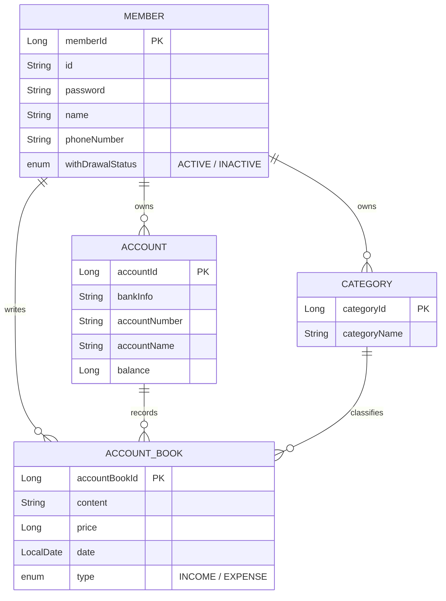

<div align="center">

# 💰 HouseholdAccountBook

**통장별로 수입·지출을 기록하고, 카테고리와 대시보드로 한눈에 확인하는 가계부 서비스**

<br/>


<br/>


</div>

---

## 📖 프로젝트 개요

**HouseholdAccountBook**은 개인의 자산 흐름을 쉽게 관리할 수 있도록 만든 가계부 애플리케이션입니다.

- 여러 개의 **통장(계좌)** 을 등록하고, 수입·지출 내역을 통장별로 기록합니다.
- 내역을 작성하면 해당 통장의 **잔액이 자동으로 반영**됩니다.
- 사용자가 직접 만든 **카테고리**로 내역을 분류하고, **대시보드**에서 월별 수입·지출과 카테고리별 지출 비중을 차트로 확인할 수 있습니다.
- 프론트엔드는 **React Native + Expo(React Native Web)** 로 작성되어 하나의 코드로 웹과 모바일(iOS/Android)을 모두 지원합니다.
- 백엔드는 **Spring Boot REST API**이며, **JWT** 기반으로 인증합니다.

---

## 🛠 기술 스택

### Backend
| 구분 | 기술 |
|---|---|
| Language | Java 21 |
| Framework | Spring Boot 4.1, Spring Web MVC |
| Security | Spring Security, JWT (jjwt 0.12), BCrypt |
| ORM | Spring Data JPA (Hibernate) |
| Database | PostgreSQL 17 |
| Etc | Lombok, log4jdbc, Gradle |

### Frontend
| 구분 | 기술 |
|---|---|
| Language | TypeScript |
| Framework | React 19, React Native 0.88, Expo SDK 58 |
| Routing | Expo Router (파일 기반 라우팅) |
| Web | React Native Web |
| Chart | 라이브러리 없이 직접 구현 (파이: react-native-svg, 막대: View) |
| Storage | expo-secure-store (토큰 저장) |
| Animation | react-native-reanimated |

### Infra / DevOps
| 구분 | 기술 |
|---|---|
| Container | Docker, Docker Compose |
| Frontend 배포 | Vercel |
| Backend / DB 배포 | Render |

---

## ✨ 주요 기능

### 👤 회원
- 회원가입 (아이디 중복 확인)
- 로그인 / 로그아웃 (JWT 발급)
- 아이디 찾기, 비밀번호 재설정
- 마이페이지: 내 정보 조회, 휴대폰번호·비밀번호 변경
- 회원탈퇴

### 🏦 통장 관리
- 통장 등록 (은행, 계좌번호, 통장 이름, 초기 잔액)
- 통장 목록 및 **총 잔액** 조회
- 잔액 직접 수정
- **통장 간 이체**
- 통장 삭제

### 📝 가계부
- 수입(`INCOME`) / 지출(`EXPENSE`) 내역 작성·수정·삭제
- 작성 시 선택한 통장의 현재 잔액 표시
- 전체 / 통장별 / 기간별 / 카테고리별 내역 조회

### 🏷 카테고리
- 사용자별 카테고리 추가·수정·삭제
- 가계부 작성 시 카테고리 선택

### 📊 대시보드
- **월별 수입·지출** 막대 차트 및 합계
- **카테고리별 지출 비중** 파이 차트 (연/월 선택 가능)

---

## 🗂 프로젝트 구조

```
HouseholdAccountBook
├── back/householdaccountbook          # Spring Boot 백엔드
│   └── src/main/java/com/seunghyun/householdaccountbook
│       ├── domain
│       │   ├── member                 # 회원
│       │   ├── account                # 통장
│       │   ├── accountbook            # 가계부 내역 / 대시보드
│       │   └── category               # 카테고리
│       ├── global
│       │   ├── config                 # Security, CORS 설정
│       │   ├── jwt                    # JWT 발급·검증 필터
│       │   └── exception              # 전역 예외 처리
│       └── healthcheck
├── front/rnwClient                    # React Native(Expo) 프론트엔드
│   └── src
│       ├── app                        # 화면 (Expo Router)
│       │   ├── index.tsx              # 로그인
│       │   ├── sign-up / find-id / find-password
│       │   └── (app)                  # 로그인 후 화면
│       │       ├── home / write / dashboard
│       │       ├── categories / mypage
│       │       └── account-settings
│       ├── api                        # 백엔드 API 호출
│       ├── components                 # 공통 UI 컴포넌트
│       ├── hooks                      # 테마 등 커스텀 훅
│       └── utils                      # 날짜·숫자 포맷 유틸
└── docker-compose.yml                 # DB + Backend + Frontend 일괄 실행
```

---

## 🧩 ERD (도메인 모델)



---

## 🔌 API 목록

> 모든 API는 `/api` 경로 하위에 있으며, 회원가입·로그인 등을 제외한 요청은 `Authorization: Bearer <JWT>` 헤더가 필요합니다.

<details>
<summary><b>회원 (Member)</b></summary>

| Method | URI | 설명 |
|---|---|---|
| POST | `/member/sign-up` | 회원가입 |
| GET | `/member/id-check/{id}` | 아이디 중복 확인 |
| POST | `/member/login` | 로그인 |
| POST | `/member/find-id` | 아이디 찾기 |
| PATCH | `/member/reset-password` | 비밀번호 재설정 |
| GET | `/member/info` | 내 정보 조회 |
| PATCH | `/member/update` | 회원 정보 수정 |
| PATCH | `/member/withdraw` | 회원탈퇴 |
</details>

<details>
<summary><b>통장 (Account)</b></summary>

| Method | URI | 설명 |
|---|---|---|
| POST | `/account/add` | 통장 등록 |
| GET | `/account/search` | 통장 목록 조회 |
| PATCH | `/account/update-balance/{accountId}` | 잔액 수정 |
| DELETE | `/account/delete/{accountId}` | 통장 삭제 |
| POST | `/account/transfer` | 통장 간 이체 |
</details>

<details>
<summary><b>가계부 (AccountBook)</b></summary>

| Method | URI | 설명 |
|---|---|---|
| POST | `/accountbook/add` | 내역 작성 |
| GET | `/accountbook/get` | 전체 내역 조회 |
| GET | `/accountbook/get/{accountId}` | 통장별 내역 조회 |
| GET | `/accountbook/get/date` | 기간별 내역 조회 |
| GET | `/accountbook/get/{accountId}/date` | 통장 + 기간별 내역 조회 |
| GET | `/accountbook/get/category` | 카테고리별 내역 조회 |
| GET | `/accountbook/dashboard` | 대시보드 데이터 |
| GET | `/accountbook/dashboard/categories` | 월별 카테고리 지출 비중 |
| PATCH | `/accountbook/update/{accountBookId}` | 내역 수정 |
| DELETE | `/accountbook/delete/{accountBookId}` | 내역 삭제 |
</details>

<details>
<summary><b>카테고리 (Category)</b></summary>

| Method | URI | 설명 |
|---|---|---|
| POST | `/category/add` | 카테고리 추가 |
| GET | `/category/get` | 카테고리 목록 조회 |
| PATCH | `/category/update/{categoryId}` | 카테고리 수정 |
| DELETE | `/category/delete/{categoryId}` | 카테고리 삭제 |
</details>

---

## 🚀 실행 방법

### 1. 환경 변수 설정
```bash
cp .env.example .env
```
`.env` 파일에 아래 값을 채워 넣습니다.

| 변수 | 설명 |
|---|---|
| `DB_PASSWORD` | PostgreSQL 비밀번호 |
| `JWT_SECRET` | JWT 서명 키 |
| `HOST_VALUE` | (배포 환경) DB 호스트 주소 |
| `DDL_AUTO` | (선택) JPA ddl-auto 값 |

### 2-A. Docker Compose로 한 번에 실행
```bash
docker compose up --build
```
| 서비스 | 주소 |
|---|---|
| Frontend | http://localhost:8081 |
| Backend | http://localhost:8080/api |
| PostgreSQL | localhost:5432 |

### 2-B. 개별 실행
```bash
# Backend
cd back/householdaccountbook
./gradlew bootRun

# Frontend
cd front/rnwClient
npm install
npm run web      # 웹
npm run ios      # iOS
npm run android  # Android
```
